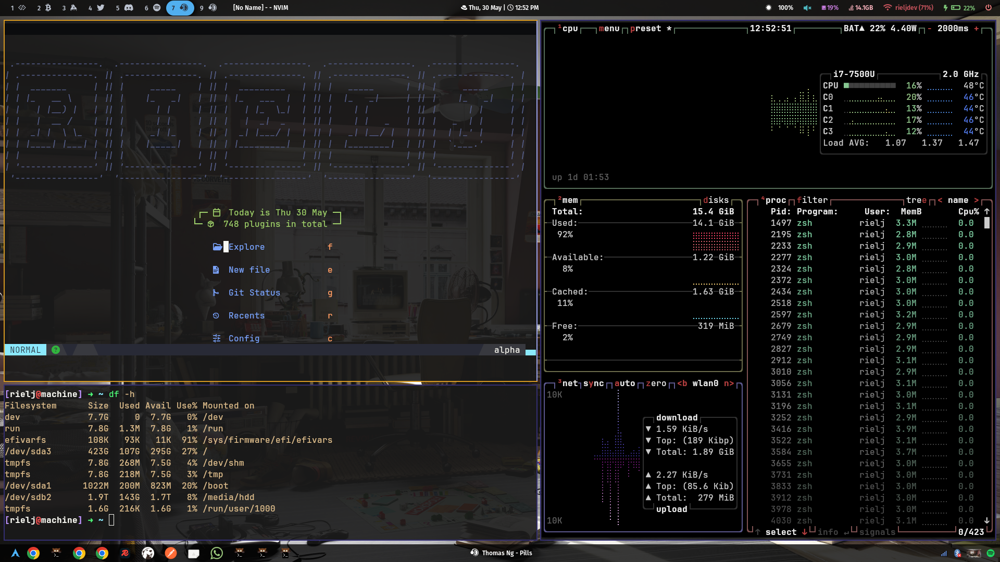
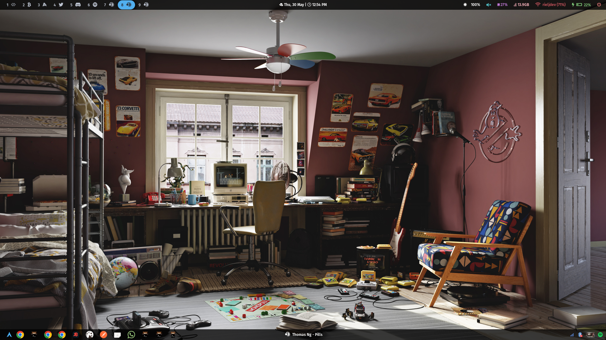

# dotfiles

My configuration for macOS and Linux, managed with [GNU Stow](https://www.gnu.org/software/stow/). Each top-level folder is one Stow package: its contents mirror where the files go under `$HOME`.

I work on macOS now. The Linux folders are from my earlier Arch Linux setup, with i3 on X11 and Sway on Wayland.

## What's here

### macOS (in use)

| Package | What it configures |
|---|---|
| `aerospace` | [AeroSpace](https://github.com/nikitabobko/AeroSpace), a tiling window manager set up to behave like Sway |
| `borders` | [JankyBorders](https://github.com/FelixKratz/JankyBorders), window borders that show the focused window |
| `sketchybar` | [SketchyBar](https://github.com/FelixKratz/SketchyBar), the status bar |
| `karabiner` | [Karabiner-Elements](https://karabiner-elements.pqrs.org/), key remapping so macOS modifier keys match Linux |
| `pi` | [Pi](https://github.com/earendil-works/pi), my AI coding agent: settings, extensions, skills and agents. See [AI coding setup](#ai-coding-setup) |
| `nvim` | Neovim, with lazy.nvim and per-language LSP settings |
| `tmux` | tmux, with a separate `macos.conf` |
| `zsh` | zsh: prompt, aliases, key bindings and vi mode |
| `lazygit` | lazygit |
| `node` | `globals.txt`, the global npm CLIs I install with `scripts/node-globals.sh` |

[MACOS_SETUP.md](MACOS_SETUP.md) lists the manual steps after stowing: accessibility permissions, the Raycast hotkey, and the macOS settings that make the Linux-style keys work.

### Linux

| Package | What it configures |
|---|---|
| `sway`, `swaylock`, `swappy` | Sway window manager, screen locker, screenshot editor |
| `waybar`, `wofi`, `mako`, `nwg-launchers` | Bar, launcher, notifications and app menu for Sway |
| `i3`, `polybar`, `rofi`, `picom`, `dunst`, `x` | The older X11 setup with i3 |
| `mimeapps`, `zathura`, `ranger` | Default apps, PDF viewer, file manager |

### Either platform

- `kitty`, `alacritty`: terminal emulators.
- `user.js`: Firefox preferences.
- `zen`: Zen browser `user.js` and mod list. Link it with `scripts/zen-link.sh`.
- `packages.txt`: packages from my Arch install.

## Install

```bash
git clone https://github.com/RielJ/dotfiles.git ~/dotfiles
cd ~/dotfiles
brew install stow          # macOS; on Arch: sudo pacman -S stow
stow nvim tmux zsh         # link the packages you want
```

Stow links each file in a package into your home directory. Existing files are not overwritten: Stow stops and reports the conflict, so move the old file first.

## AI coding setup

The `pi` package is my setup for [Pi](https://github.com/earendil-works/pi), the terminal coding agent I use every day. It links to `~/.pi`. Session data and long-term memories stay on my machine and are never committed.

### Ground rules

[`AGENTS.md`](pi/.pi/agent/AGENTS.md) holds the rules every session loads. The main ones:

- The agent never commits or pushes unless I ask, and never force-pushes or rewrites pushed history.
- Work goes in small vertical slices: read first, make the smallest complete change, test it, then move on.
- When the agent repeats a mistake, the fix goes as high as it can: architecture, then types, then a lint or test, and only last a written rule. The table at the end of `AGENTS.md` records what enforces each rule.

### Extensions I wrote

In [`pi/.pi/agent/extensions`](pi/.pi/agent/extensions):

- **superpowers**: runs several models side by side. `/plan` gets plans from four models, and `/review` gets four independent code reviews that report only merge-blocking problems. It also adds local knowledge-base search ([QMD](https://github.com/tobi/qmd)) and web search.
- **damage-control**: checks every shell command against [`damage-control-rules.yaml`](pi/.pi/agent/damage-control-rules.yaml). Hard rules (force push, `--amend`, `reset --hard`) are blocked outright. Other risky commands ask Block or Allow once, and block if nobody answers within two minutes.
- **memory**: long-term memory across sessions, stored as Markdown in a local git repository under `~/.pi/memory`, outside every project and never pushed.
- **git-workflow**: `/commit`, `/pr` and `/commit-and-pr`, which group changes into conventional commits by logical change and open pull requests with `gh`. Commit messages never credit an AI.
- **telegram-question-bridge**: lets the agent ask me questions over Telegram when I'm away from the terminal.
- **usage**: `/usage`, a dashboard of usage per provider for today, this week, last week, the last 30 days and all time.
- **pi-notify**: a desktop notification when the agent is waiting for me and the terminal isn't focused.
- Smaller fixes: `anthropic-tool-schema-compat` and `image-media-type-guard` work around provider API errors; `session-utils` adds `/clear`; `shortcuts` lists every key binding in one place.

Two extensions are forks of [amosblomqvist](https://github.com/amosblomqvist)'s MIT-licensed projects, with my changes:

- **subagents**, from [pi-interactive-subagents](https://github.com/amosblomqvist/pi-interactive-subagents): each subagent runs in its own tmux window, optionally in its own git worktree.
- **prompt-snippets**, from [pi-config](https://github.com/amosblomqvist/pi-config): single-purpose prompt rules toggled per message.

### Skills and agents

- [`skills/`](pi/.pi/agent/skills): instructions the agent loads when a task matches, such as `systematic-debugging`, `tdd`, `blast-radius`, `correct`, `technical-writing` and `typescript-best-practices`.
- [`agents/`](pi/.pi/agent/agents): role definitions for subagents, such as planner, builder, reviewer, red team and scout.

### Packages

[`settings.json`](pi/.pi/agent/settings.json) lists the community packages I install, including [pi-lens](https://www.npmjs.com/package/pi-lens) for LSP diagnostics, [pi-fff](https://www.npmjs.com/package/@ff-labs/pi-fff) for fast file search, [pi-vcc](https://www.npmjs.com/package/@sting8k/pi-vcc) for context compaction, and [pi-mcp-adapter](https://www.npmjs.com/package/pi-mcp-adapter) for MCP servers.

I also publish two Pi packages of my own:

- [pi-git-worktrees](https://github.com/RielJ/pi-git-worktrees): runs agent sessions in parallel, each in its own git worktree.
- [pi-image-preview](https://github.com/RielJ/pi-image-preview): shows images inline in the terminal with the kitty graphics protocol, including inside tmux.

## Screenshots




